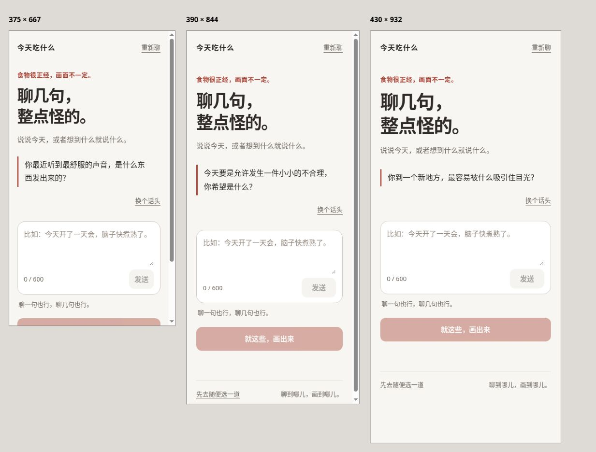

# 本轮验收记录

日期：2026-11-19。范围是代码、构建和本地页面；本轮没有部署，也没有调用真实付费文本或图片模型。

## 自动化验证

`npm test`：65 项通过，0 项失败。测试包括：

- 240 句本地开场的唯一性、长度、随机选择与轮换。
- 风格、错配、氛围候选库的选择，以及结构化计划的字段、长度、食物和证据约束。
- 线索证据必须来自用户原话；图片提示词不拼接原始对话、线索引文或测试中的私人信息。
- 主体、锚定物、错配关系和受控发散保留在编译后的提示词中；可选修饰不会挤掉核心内容。
- 聊天、构思、绘图的完整模拟链路；签名、过期、输入长度、来源、模型异常和明确拒绝。
- 实际 SQLite 执行 D1 使用的 SQL，验证预算预留、重复请求、每日限量及完成记录不可降级。
- 两个独立模块实例共享 D1 和模拟 R2：同一计划的重复请求从 R2 恢复同一张图，图像端点只调用一次。
- 超时结果不明、记账已提交但确认失败、断线重试都不会自动再次出图。
- 前端换话头、发送、错误分类、取消、手动重试、保存现有图片以及继续聊天。
- 原有首页、唤醒动画、资源、分享和 Service Worker 的回归检查。

`npm run build` 及生成 Worker 的导入检查通过。构建是零运行时依赖的客户端静态资源和单文件 Worker；构建中不包含密钥或说明文档。

## 浏览器检查

在受管本地预览中实际执行：首页跳过开场 → 新聊天页 → 换本地话头 → 输入并发送一句话 → 未配置 API 的预期提示 → 重新聊。未配置时保留返回随机选菜的入口。

使用三种尺寸的 iframe 检查真实页面 CSS：375 × 667、390 × 844、430 × 932。未见横向溢出；普通按钮高度至少 44 px，绘图按钮为 54 px。前两档桌面滚动条占用 15 px，所以实际内容视口分别为 360 px 和 375 px；这是布局检查，不等于真机键盘、系统分享面板或 iOS Safari 验收。

## 部署后还要观察的效果

自动化测试只能约束结构与请求行为，不能证明模型的食物猜测、忌口理解、笑点或绘画质量。`tests/fixtures/food-plan.mjs` 的 `LIVE_EVALUATION_CASES` 留了 8 类真实模型样例：明确食物、忌口纠正、无线索中文对话、探索出游、疲惫、烦躁、通感、提示注入。

上线后先用少量样图检查三个问题：食物是否能认出，错配是否有可见的共同点，风格是否盖住了关系。先修改提示词和方向库，再决定是否提升规划模型或图片画质。记录真实 `usage`，以实际账单校准估算；本轮没有实测出图耗时或每次完整对话费用。
